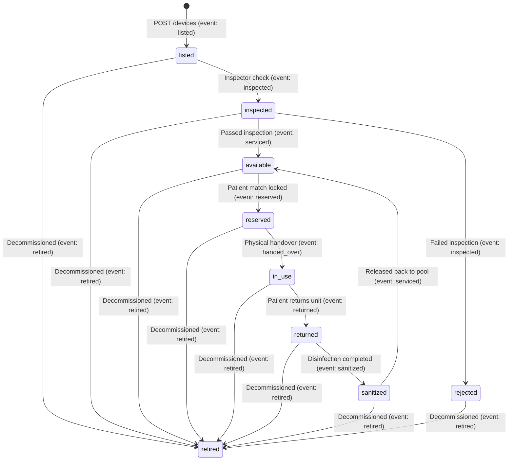

# MedLoop Architecture & Database Design (`docs/design.md`)

> **Disclaimer**: MedLoop enforces and records an equipment inspection, sanitization, and custody workflow. It does **not** verify the physical safety of any medical device. All records in this repository are synthetic, and real-world medical equipment reuse in India is subject to Central Drugs Standard Control Organization (CDSCO) regulations and clinical liability standards.

## 1. SQL vs NoSQL Justification for MedLoop

MedLoop manages six categories of home-care medical equipment (`wheelchair`, `hospital_bed`, `oxygen_concentrator`, `nebulizer`, `walker`, `bp_monitor`), tracks hyperlocal GeoJSON coordinates across Indian cities, and logs an append-only audit trail of custody and maintenance events. Choosing a document database (MongoDB) over a relational database (PostgreSQL/MySQL) is justified by three concrete workload characteristics:

1. **Polymorphic Equipment Specifications (`devices.specs`)**:
   - A wheelchair requires mechanical dimensions (`seat_width_cm`, `max_load_kg`, `foldable`), whereas an oxygen concentrator requires pneumatic and runtime telemetry (`flow_lpm`, `hours_used`, `oxygen_purity_pct`) and a hospital bed tracks articulation (`fowler_type`, `side_rails`, `mattress_included`).
   - In a relational schema, modeling category-specific attributes requires either a sparse single table with dozens of nullable columns, six separate subtype tables requiring `LEFT JOIN` queries, or an Entity-Attribute-Value (EAV) anti-pattern that sacrifices type safety.
   - In MongoDB, `specs` is stored as a nested BSON sub-document inside each `devices` document. Every category stores its exact attributes cleanly in a single read operation while `$jsonSchema` still validates cross-cutting numeric invariants (such as `specs.hours_used >= 0` whenever present).
2. **Native Geospatial Indexing (`2dsphere`) and `$geoNear` Matching**:
   - Hyperlocal patient-to-device matching requires spherical distance calculations on WGS84 `[longitude, latitude]` coordinates combined with compound BSON predicates (`category`, `status: "available"`, and inspection freshness). MongoDB provides native GeoJSON storage, S2-geometry `2dsphere` indexes, and the `$geoNear` aggregation stage out of the box without installing external spatial extensions.
3. **Flexible Event Payloads (`events.details`)**:
   - Different lifecycle transitions record different audit metadata: an `"inspected"` event stores `{"result": "pass", "checklist": [...]}`, a `"sanitized"` event stores disinfectant details, and a `"retired"` event records decommissioning reasons. Document storage captures this semi-structured audit payload natively alongside strongly typed envelope fields (`device_id`, `type`, `actor_id`, `ts`, `from_status`, `to_status`).

## 2. CAP Theorem Trade-off (MongoDB Atlas Replica Sets)

In terms of the **CAP Theorem** (Consistency, Availability, Partition Tolerance), distributed databases must choose between **Consistency (CP)** and **Availability (AP)** when a network partition (**P**) occurs:

- **MongoDB Replica Sets Favor CP (Consistency + Partition Tolerance)**:
  - A MongoDB Atlas M0 cluster operates as a 3-node replica set with **one Primary node** and **two Secondary nodes**.
  - By default, all writes go to the Primary node, and reads Directed to the Primary return the latest committed state.
  - If a network partition isolates the current Primary from a majority of voting nodes, the isolated Primary steps down to become a Secondary and stops accepting writes, while the remaining majority partition elects a new Primary via an Raft-like consensus protocol.
- **Why CP Fits MedLoop**:
  - When two patients attempt to reserve the same oxygen concentrator simultaneously, preventing a double-allocation is more important than accepting stale writes on a partitioned node.
  - MedLoop pairs MongoDB's single-Primary CP architecture with an atomic `find_one_and_update` compare-and-swap filter (`{"_id": device_oid, "status": current_status}`) inside `POST /devices/{id}/transition`, guaranteeing that only one concurrent state transition succeeds while the second receives `HTTP 409 Conflict`.

## 3. Embed vs Reference Decisions & Cardinality Modeling

| Relationship | Cardinality | Strategy | Justification |
| :--- | :--- | :--- | :--- |
| `devices` $\leftrightarrow$ `specs` | **1 : 1** | **Embedded** (`devices.specs`) | Specifications belong exclusively to a single physical device, have bounded size (< 200 bytes), and are always fetched together with the device summary. Embedding achieves 1-read locality without joins. |
| `users` $\leftrightarrow$ `devices` | **1 : N** | **Referenced** (`devices.owner_id` $\rightarrow$ `users._id`) | A donor user can contribute multiple devices, and user profile lookups are independent of device searches. Referencing avoids duplicating donor metadata across devices. |
| `devices` $\leftrightarrow$ `events` | **1 : N (Unbounded)** | **Referenced, Append-Only** (`events.device_id` $\rightarrow$ `devices._id`) | Every inspection, sanitization, reservation, handover, and return appends a new audit record. Because a durable device may undergo hundreds of loan cycles over several years, `events` **grows without bound**. Embedding `events` inside `devices` would cause continuous document reallocation and eventually threaten MongoDB's 16 MB BSON document limit. Storing `events` as a separate append-only collection indexed by `{device_id: 1, ts: -1}` keeps `devices` documents small and fast to update. |
| `users` $\leftrightarrow$ `requests` | **1 : N** | **Referenced** (`requests.requester_id` $\rightarrow$ `users._id`) | Patient requests have an independent 14-day TTL lifecycle (`expires_at`) and are queried in aggregate by `{category, city}` for shortage forecasting. |
| Inspectors $\leftrightarrow$ Categories | **M : N** | **Embedded Bounded Array** (`users.certified_categories`) | See Section 4 below. |

## 4. Many-to-Many (M:N) Relationship: Inspectors $\leftrightarrow$ Categories

In MedLoop, each inspector can be certified to inspect multiple equipment categories (for example, `["oxygen_concentrator", "nebulizer", "hospital_bed"]`), and each equipment category has multiple certified inspectors across cities.

Instead of introducing a relational junction collection (`inspector_category_map`), MedLoop models this **M:N** relationship by storing an array of category strings (`certified_categories`) directly inside inspector documents in the `users` collection:

1. **Bounded Cardinality**: The domain has a fixed, small set of 6 equipment categories (`wheelchair`, `hospital_bed`, `oxygen_concentrator`, `nebulizer`, `walker`, `bp_monitor`). The array inside `users.certified_categories` never exceeds 6 elements.
2. **Schema Enforcement**: The `users` collection `$jsonSchema` validates every element of `certified_categories` against the canonical category `enum`.
3. **Zero-Join Queries**: Finding all inspectors certified for `"oxygen_concentrator"` in `"Ludhiana"` requires a single collection query `db.users.find({"role": "inspector", "city": "Ludhiana", "certified_categories": "oxygen_concentrator"})` without `$lookup`.

## 5. Device Lifecycle State Machine (`stateDiagram-v2`)

Every device transitions through a strict workflow enforced in `app/state_machine.py` (`is_valid_transition`) and recorded in `events`:

## 6. Honest Limitation of `$jsonSchema` Validation

In `db/setup.py`, all four collections enforce `$jsonSchema` rules with `validationLevel: "strict"` and `validationAction: "error"`. Specifically, the `devices` validator enforces:

- Required fields and strict `enum` sets for `category` and `status`.
- `purchase_value` must be a BSON `Decimal128` (`bsonType: "decimal"`) to prevent IEEE-754 floating-point rounding errors on monetary values.
- `specs.hours_used`, where present, must satisfy `minimum: 0`.
- `location` must be a valid GeoJSON `Point` with a 2-element coordinate array.
- **Conditional Rule (`anyOf`)**: If `requires_inspection` is `true` and `status` is `"available"`, then `last_inspection_at` is required and must be a non-null BSON `Date`.

**Why the 180-Day Inspection Window Is Enforced in `GET /match/{request_id}`**:
MongoDB's `$jsonSchema` validator evaluates documents statically against constants defined at collection-creation time; it **cannot** reference the dynamic runtime clock (`$$NOW` or `datetime.now()`) to assert that `last_inspection_at >= now - 180 days`. Even if a dynamic expression were evaluated on write, a device that was inspected 10 days ago would pass validation when written and silently become >180 days stale six months later without any write event occurring. Therefore:
1. `$jsonSchema` enforces the **structural invariant** at write time (`requires_inspection == true` and `status == "available"` requires a `Date` in `last_inspection_at`).
2. `GET /match/{request_id}` (Pipeline 3) and `GET /analytics/overdue` (Pipeline 1) enforce the **temporal freshness rule** (`last_inspection_at >= now - 180 days`) dynamically at query time.

## 7. Production Readiness Notes

When deploying MedLoop beyond an academic environment onto MongoDB Atlas, five operational safeguards apply:

1. **Least-Privilege Database User**: Create a dedicated application database user scoped strictly to `readWrite` on the `medloop` database (`readWrite@medloop`), never `atlasAdmin` or `dbAdminAnyDatabase` for runtime API traffic.
2. **Network IP Allowlist**: Restrict network ingress in MongoDB Atlas to the specific CIDR blocks or NAT gateway IPs of the FastAPI application servers; never leave `0.0.0.0/0` enabled in production.
3. **Automated Backups & Point-in-Time Recovery**: Upgrade from the free M0 tier to an M10+ cluster in production to enable continuous cloud snapshots and point-in-time recovery for the append-only `events` custody log.
4. **TTL Index Housekeeping**: The TTL index on `requests.expires_at` (`expireAfterSeconds: 0`) relies on MongoDB's background TTL monitor thread (which runs every 60 seconds) to automatically purge expired patient requests without manual cron jobs.
5. **Secrets in Environment Variables**: Connection strings (`MONGO_URI` containing database credentials) and `DB_NAME` are loaded exclusively from environment variables via `python-dotenv` (`.env` is listed in `.gitignore` and never committed to version control).
